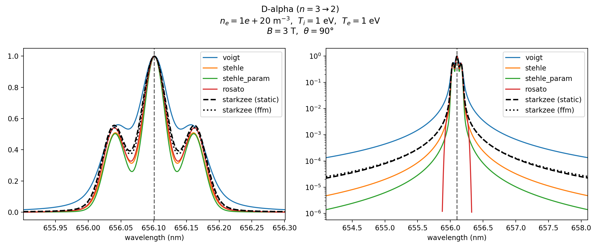

# StarkZee

**Coupled Stark-Zeeman plasma line-shape model for hydrogen-like and multi-electron radiators.**

StarkZee implements the Standard Lineshape Theory for emission lines of hydrogen-like ions in a magnetized plasma.
Multi-electron lines (He I, one-valence-electron ions such as C IV, or levels from FAC and Cowan's RCG) use the same solvers through a radiator object.
Ions are treated in the quasi-static approximation: the ion microfield at the radiator site is assumed stationary on the timescale of the emitted photon, and the spectral profile is obtained by averaging Stark-Zeeman Hamiltonians over the ion microfield distribution.
Electron broadening is represented by weak binary collisions within the Griem–Baranger–Kolb (GBK) binary-collision relaxation model, which accounts for the suppression of broadening at large frequency detunings through a semi-classical exponential-integral factor and a magnetic-field-dependent lower cutoff.

The static magnetic field enters the radiator Hamiltonian directly — within the electric-dipole approximation — producing coupled Stark-Zeeman energy levels and polarized π and σ± emission components.
Ion dynamics (the finite velocity of the perturbing ions) are optionally included via the Frequency Fluctuation Model (FFM), which treats the microfield as a Markovian jump process between quasi-static configurations.
The default screened microfield uses the Potekhin fits; unscreened mode uses Holtsmark. Supply ion temperature explicitly: if it is missing for the default screened model, the code warns and assumes Ti=Te. 

Static, FFM, and discrete-transition calculations default to
`use_empirical_data=True`, using bundled NIST levels for H, D, and T (H: n ≤ 8,
D: n ≤ 6, T: n ≤ 3 with fine structure; higher levels use the Dirac energy below
the ionization limit, with a warning). The level table follows the isotope `A`
(default: the most abundant isotope of Z). Set `use_empirical_data=False` for
analytical energies or hydrogen-like ions with `Z > 1`. Nuclear motion enters
through the reduced mass (energies, fine structure, lengths in the reduced Bohr
radius, radiative rates) and g_L = 1 - m_e/M; `A=math.inf` gives the
infinite-mass limit. Low-level Hamiltonian functions retain their analytical
default and eV output convention.


---

## Features

- Full Stark-Zeeman Hamiltonian diagonalization at each microfield quadrature point — spin-orbit, linear Zeeman, quadratic (diamagnetic) Zeeman, and Stark perturbation
- Potekhin screened (default), Holtsmark unscreened, and explicit legacy
  Hooper-like microfield distributions
- GBK electron impact broadening with frequency-dependent width and Larmor-frequency cutoff
- Opt-in PPP impact-limit collision matrix with upper/lower interference and
  complex generalized Stark-dressed-transition weights
- Frequency Fluctuation Model (FFM) for dynamic ion broadening
- Explicit emitter/background charge and mass separation, with selectable
  ZEST or PPP-manual ion-fluctuation rates
- Optional in-solver thermal Doppler broadening plus standalone FFT Doppler and instrumental helpers
- Observation-angle decomposition: π, σ+, σ− polarization components
- Spectral grids in any unit system: wavelength [nm], energy [eV], frequency [THz], wavenumber [cm⁻¹]
- Discrete stick spectrum at arbitrary field configurations
- Public radial wavefunctions, signed dipoles, line strengths, and E1 rates
- Multi-shell DC Stark maps with target-state overlap plots
- Multi-electron radiators from LS terms or J-level data (FAC, Cowan RCG), with
  exact, weak- or strong-field Zeeman treatment, the diamagnetic term, and a
  level-resolved electron-impact operator; ready-made He I 447.1 nm and Li-like
  C IV, N V and O VI n = 5 → 4 lines

---

## Installation

```bash
git clone https://github.com/gronchi/starkzee.git
cd starkzee
pip install -e .

```

Optional: with [numexpr](https://pypi.org/project/numexpr/) installed (`pip install -e .[fast]`),
the static-profile Lorentzian kernel (grid x Stark-Zeeman components, the dominant cost)
is evaluated in one fused, multithreaded pass, 2-6x faster per profile with the same
result to rounding (`python scripts/benchmark_static_profile.py`). Without it the kernel
runs in place in numpy.

`calculate_static_profile(..., method='fft', fft_tol=1e-8)` is an opt-in approximate
evaluation (the default `method='exact'` is unchanged): the components of all quadrature
points are summed with FFT convolutions (`starkzee.lorentzian_fft`), with the error held
below `fft_tol` of the peak. It is ~50x faster for constant widths with Doppler (direct
Voigt kernels) and 1.3-2x for the default frequency-dependent widths; the per-state
electron operator with frequency-dependent widths is slower than exact.

Optional: with [pywigxjpf](https://pypi.org/project/pywigxjpf/) installed (`pip install -e .[wigner]`),
Wigner 3-j and 6-j symbols use the exact WIGXJPF library instead of the built-in
double-precision Racah sums (`starkzee.angular.BACKEND` shows which is active). pywigxjpf has
no Windows wheels; with the Microsoft C++ Build Tools it builds with

```powershell
$env:CL = "/DTRAIL_ARRAY_EMPTY"
pip install --no-build-isolation pywigxjpf      # needs numpy, cffi and pycparser installed
```

---

## Quick start

```python
import numpy as np
import matplotlib.pyplot as plt
from starkzee.line_profile import LineProfile

# Hydrogen Balmer-α (n=3→2) at typical tokamak edge conditions
lp = LineProfile(n_u=3, n_l=2, B=5.0, Ne_m3=1e20, Te_ev=5.0)

# Provide the spectral grid in any unit system
wl_grid = np.linspace(lp.E0_wavelength_nm - 1.0,
                      lp.E0_wavelength_nm + 1.0, 1000)
lp.compute_profile(wl_grid, grid_type='wavelength_nm')

# Polarization components and observation-angle combinations
lp.profile_transverse   # π + ½(σ⁺ + σ⁻)  — perpendicular to B
lp.profile_parallel     # σ⁺ + σ⁻          — along B
lp.profile_at_angle(45) # Stokes formula at arbitrary θ

# Detuning grids are always available in all unit systems
lp.detuning_nm          # λ − λ₀  [nm]
lp.detuning_ev          # E − E₀  [eV]
lp.detuning_thz         # f − f₀  [THz]
lp.detuning_cm          # ν̃ − ν̃₀ [cm⁻¹]

# Quick plot
plt.plot(lp.detuning_nm, lp.profile_transverse)
plt.xlabel(r"$\lambda - \lambda_0$  (nm)")
plt.show()
```

### Discrete stick spectrum

```python
lp.compute_discrete(Fz=0.0, Fx=0.0)
for dλ, q, s in zip(lp.discrete.detuning_nm, lp.discrete.q, lp.discrete.strength):
    print(f"  Δλ = {dλ:+.4f} nm   q = {q:+d}   |d|² = {s:.4f} a₀²")

transition_rates = lp.discrete.einstein_a_s
upper_partial_rates = lp.discrete.upper_partial_decay_rate_s
```

Rates are in s⁻¹ and include only retained transitions into the selected
lower shell. Use `min_strength=0.0` when requesting all nonzero strengths
for a rate sum. These partial rates do not define total lifetimes.

### Atomic data and Stark maps

```python
from starkzee import atomic
from starkzee.stark_map import StarkMap

strength = atomic.line_strength(3, 2)       # a0², summed over both shells and q
gf = atomic.oscillator_strength(3, 2)      # weighted absorption strength g_l*f_lu
rate = atomic.einstein_a(3, 2, A=1)        # s^-1, upper-shell average into n=2

result = StarkMap(shells=(2, 3, 4, 5), B=5.0).compute(
    np.linspace(0.0, 3e6, 161),            # V/m
    target_state=(3, 2, 2.5, 0.5),         # n, l, j, mj
)
fig, ax = result.plot()                   # V/cm, GHz; color is target overlap
ax.set_ylim(-500, 500)
```

The [atomic-data guide](docs/source/atomic_api.rst) explains radial
wavefunctions, strength and rate conventions, and the separate multi-shell
map model. Reproduce its three plots with
`python examples/atomic_api_and_stark_maps.py`.

### With Doppler and instrumental broadening

The ``lp`` above has no ``Ti_ev``, so its static profile is Doppler-free and
can be broadened explicitly. If ``Ti_ev`` was supplied to ``LineProfile``, the
static solver already included Doppler and this first convolution must be
skipped.

```python
from starkzee.convolutions import apply_doppler_broadening, apply_instrument_broadening

profile = apply_doppler_broadening(
    lp.wavelengths_nm, lp.profile_transverse,
    Ti_ev=5.0, species='H',
)
profile = apply_instrument_broadening(lp.wavelengths_nm, profile, fwhm_nm=0.05)
```

### FFM (ion dynamics)

```python
from starkzee.ffm import calculate_ffm_profile

pi, sp, sm = calculate_ffm_profile(
    n_u=3, n_l=2, Z=1, B=5.0, Ne_m3=1e20, Te_ev=5.0, Ti_ev=5.0,
    A_ion=1, energies_ev=lp.energies_ev,
)
```

Here `A_ion` is the emitter mass. Same-species plasma remains the default. For
a heavy hydrogen-like emitter in a proton background, pass
`A_perturber=1`, `emitter_charge=Z-1`, and optionally
`fluctuation_rate_model="ppp"` to use the PPP-manual reduced-mass rate instead
of the default ZEST rate. The current Potekhin fit distinguishes neutral from
charged emitters but does not depend on the magnitude of `emitter_charge`.

### Multi-electron lines

Build a radiator once per field and pass it to either solver; `n_u`, `n_l`
and `Z` are then ignored:

```python
import numpy as np
from starkzee.single_valence import c_iv_5_4
from starkzee.static_profile import calculate_static_profile

B = 100.0
radiator = c_iv_5_4(B)                       # C IV n = 5 -> 4, 253 nm, NIST levels
grid = radiator.line_energy_ev + np.linspace(-0.05, 0.05, 1601)
pi, sp, sm = calculate_static_profile(5, 4, 4, B, 2e24, 10.0, grid, radiator=radiator,
                                      Ti_ev=10.0, electron_operator=True)
```

`calculate_ffm_profile(None, None, None, B, Ne, Te, Ti, None, grid, radiator=radiator)`
adds ion dynamics. Other lines: `starkzee.he_i.he_i_4471`,
`starkzee.ls_radiator.LSTransition` (LS terms) and
`starkzee.jlevel_radiator.JLevelTransition` with `starkzee.fac_reader.read_fac`
or `starkzee.cowan_reader.read_rcg`. See the manual chapter "Multi-electron
emitters".

### Comparison with all models — D_γ

```python
import numpy as np
import matplotlib.pyplot as plt
from starkzee.line_profile import LineProfile
import starkzee.models as models

# D_γ (n=5→2) at low-density edge conditions
Ne_m3   = 1e19    # electron density   [m⁻³]
Te_ev   = 0.5     # electron temperature [eV]
Ti_ev   = 0.5     # ion temperature      [eV]
B       = 3.0     # magnetic field       [T]
n_u, n_l = 5, 2
half_width_nm = 1.5

# Ti_ev supplied → compute_profile applies Doppler broadening automatically
lp = LineProfile(n_u=n_u, n_l=n_l, B=B, Ne_m3=Ne_m3,
                 Te_ev=Te_ev, Ti_ev=Ti_ev, species='D', view_angle_deg=90.0)

wl_vac = np.linspace(lp.E0_wavelength_nm - half_width_nm,
                     lp.E0_wavelength_nm + half_width_nm, 1000)
lp.compute_profile(wl_vac, grid_type='wavelength_nm')
sz = lp.profile

# Comparison models share the same air-wavelength grid
wl = np.linspace(lp.E0_wavelength_air_nm - half_width_nm,
                 lp.E0_wavelength_air_nm + half_width_nm, 1000)

fig, (ax1, ax2) = plt.subplots(1, 2, figsize=(11, 4),
                               sharex=False, sharey=False)
fig.suptitle(r'D$_\gamma$  —  '
             f'$N_e={Ne_m3:.0e}$ m$^{{-3}}$, '
             f'$T_i=T_e={Ti_ev}$ eV, $B={B}$ T')

for ax in (ax1, ax2):
    ax.plot(lp.wavelengths_air_nm, sz / sz.max(),
            'k--', lw=2, label='StarkZee', zorder=10)

comparison_models = [
    ('Voigt',          models.voigt),
    ('Stehle',         models.stehle),
    ('Stehle (param)', models.stehle_param),
    ('Lomanowski',     models.lomanowski),
    ('Rosato',         models.rosato),
]
for label, func in comparison_models:
    try:
        p = func(wl, n_u, n_l, B, Ne_m3, Te_ev, Ti_ev, species='D')
        ax1.plot(wl, p / p.max(), label=label, alpha=0.85)
        ax2.plot(wl, p / p.max(), label=label, alpha=0.85)
    except Exception as exc:
        print(f'{label}: {exc}')

ax1.set_xlabel('wavelength (nm)')
ax1.set_ylabel('normalized intensity')
ax1.legend(fontsize=9)
ax1.grid(ls=':', alpha=0.4)

ax2.semilogy()
ax2.set_xlabel('wavelength (nm)')
ax2.grid(ls=':', alpha=0.4)

plt.tight_layout()
plt.show()
```



---

## Package overview

| Module | Role |
|--------|------|
| `line_profile.py` | `LineProfile` — main high-level API |
| `static_profile.py` | Static Stark-Zeeman solver; Gauss-Legendre quadrature over the microfield |
| `ffm.py` | Frequency Fluctuation Model for dynamic ion broadening |
| `radiator.py` | Quantum basis, wavefunctions, dipole transitions, and Hamiltonian construction |
| `radiators.py` | Radiator interface of the solvers, hydrogenic radiator, Zeeman treatments |
| `ls_radiator.py`, `jlevel_radiator.py` | Multi-electron radiators from LS terms or J-level data |
| `level_data.py`, `fac_reader.py`, `cowan_reader.py` | J-level data model and the FAC and Cowan RCG readers |
| `coulomb_approximation.py` | Coulomb-approximation radial integrals |
| `level_collision.py` | Electron-impact operator for non-degenerate levels |
| `single_valence.py`, `he_i.py` | Ready-made radiators: Li-like n = 5 → 4 lines, He I 447.1 nm |
| `microfield.py` | Hooper and Holtsmark microfield distributions |
| `broadening.py` | GBK electron impact width with Larmor-frequency cutoff |
| `collision.py` | Opt-in PPP non-Hermitian impact-limit collision operator and complex SDTs |
| `convolutions.py` | Standalone wavelength-space FFT Doppler and instrumental broadening helpers |
| `atomic_data.py` | NIST atomic energy-level database loader (`starkzee/data/atomic_levels.json`) |
| `utils.py` | Physical constants (CODATA via scipy) and unit conversions |

---

## Physics summary

The radiator Hamiltonian in the uncoupled $|n,l,m_l,m_s\rangle$ basis:

$$H_A = H_0 + V_\text{SO} + H_Z^{(1)} + H_Z^{(2)}$$

| Term | Expression |
|------|-----------|
| Unperturbed | $H_0 = -Z^2\,\text{Ry}/n^2$ |
| Spin-orbit | $V_\text{SO} = \xi\,\vec{L}\cdot\vec{S}$ |
| Linear Zeeman | $H_Z^{(1)} = \mu_B B\,(m_l + g_s m_s)$ |
| Quadratic Zeeman | $H_Z^{(2)} = \dfrac{e^2B^2}{8m_e}r^2\sin^2\theta$ |

The Stark perturbation $V_E = -e(zF_z + xF_x)$ is added and the combined Hamiltonian diagonalized at each microfield quadrature point.  The static profile is the microfield-weighted sum of Lorentzian-broadened transition intensities.

The FFM treats the ion microfield as a Markovian jump process:

$$I(\omega) = \frac{r^2}{\pi}\,\mathrm{Re}\,\frac{S(\omega)}{1 - \nu_i S(\omega)}, \qquad S(\omega) = \sum_k \frac{p_k}{\nu_i + \gamma_k + i(\omega - \omega_k)}$$

Full derivations are in [`docs/manual.tex`](docs/manual.tex) and the [Sphinx documentation](docs/source/).

---

## Documentation

A comprehensive PDF manual detailing the physics and implementation is available in the `docs` folder. To compile the LaTeX manual `docs/manual.tex`:

- **Windows**: Run the batch file `docs/compile_manual.bat`. It will perform a double-pass compilation and automatically handle PDF reader file locks.
- **Linux / macOS**: run `pdflatex manual.tex` twice inside `docs/` (or use
  `latexmk -pdf manual.tex`). The `docs/Makefile` builds the Sphinx manual, not
  the standalone PDF.

---

## Scope and limitations

- The built-in path treats radiators as **hydrogen-like** (one electron, nuclear charge Z). Multi-electron lines need a radiator object; the LS radiator assumes pure LS terms, so intercombination lines and intermediate coupling need level data (FAC, RCG).
- The hydrogenic solver uses **exact analytical** hydrogenic radial matrix elements within the $n$-shell; coupling to adjacent shells (quadratic Stark) is neglected. Multi-electron radiators couple only the levels placed in their manifolds.
- Multi-electron radiators in the FFM do not support `electron_interference` or `sdt_frequency_dependent_width`.
- **Doppler broadening**: FFM applies it internally by default (`apply_doppler=True`); the static solver applies it internally when `Ti_ev` is supplied. Instrumental broadening is always explicit post-processing via `convolutions.py`.

---

## License

MIT — see [LICENSE](LICENSE).
