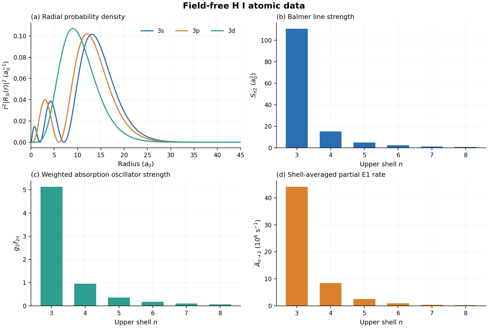
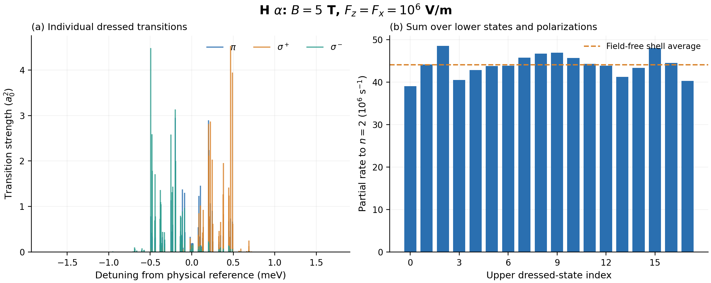
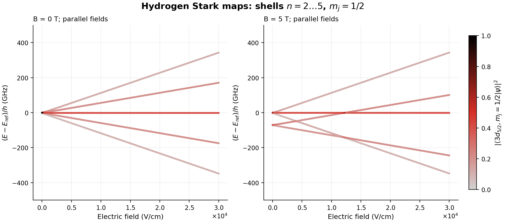

Atomic data and Stark maps
==========================

Use :mod:`starkzee.atomic` to access field-free hydrogenic data,
:meth:`~starkzee.line_profile.LineProfile.compute_discrete` for transitions
at a specified electric field, and :class:`~starkzee.stark_map.StarkMap` for
an electric-field sweep in a multi-shell basis. These calculations do not
require a broadened plasma profile.

The examples and all three figures on this page come from
``examples/atomic_api_and_stark_maps.py``. From the repository root, regenerate
them with:

.. code-block:: console

   python examples/atomic_api_and_stark_maps.py

The script uses NumPy, SciPy, and Matplotlib, writes to
``docs/figures/examples/``, and runs without ARC or downloaded atomic data.
Use ``--output-dir PATH`` to select another output directory.

.. literalinclude:: ../../examples/atomic_api_and_stark_maps.py
   :language: python
   :start-after: IMPORTS_BEGIN
   :end-before: IMPORTS_END

Field-free wavefunctions, strengths, and rates
----------------------------------------------

The public functions accept the nuclear charge ``Z`` (default 1). Radial
coordinates and matrix elements use Bohr-radius units. A radial function
obeys :math:`\int_0^\infty r^2 |R_{nl}(r)|^2\,dr=1`; the radial probability
density is :math:`r^2|R_{nl}|^2`, rather than :math:`|R_{nl}|^2` alone.
Import NumPy as ``np`` before running the following excerpt:

.. literalinclude:: ../../examples/atomic_api_and_stark_maps.py
   :language: python
   :start-after: FIELD_FREE_BEGIN
   :end-before: FIELD_FREE_END
   :dedent: 4

.. list-table:: Field-free quantities
   :header-rows: 1
   :widths: 37 15 48

   * - Function in ``atomic``
     - Units
     - Meaning
   * - ``radial_wavefunction(r_a0, n, l)``
     - :math:`a_0^{-3/2}`
     - Coulomb radial basis function, evaluated at radii in :math:`a_0`.
   * - ``radial_dipole(n1, l1, n2, l2)``
     - :math:`a_0`
     - Signed radial dipole integral; angular factors are separate.
   * - ``reduced_hydrogenic_dipole_j(...)``
     - :math:`a_0`
     - Signed :math:`J`-reduced dipole, including angular recoupling.
   * - ``line_strength(n_u, n_l)``
     - :math:`a_0^2`
     - Squared dipoles summed over both complete shells and all three
       polarizations, without population weights.
   * - ``oscillator_strength(n_u, n_l)``
     - Dimensionless
     - Weighted absorption oscillator strength :math:`g_l f_{lu}`.
   * - ``einstein_a(n_u, n_l, A=None)``
     - :math:`\mathrm{s}^{-1}`
     - E1 rate into the specified lower shell, averaged over the full upper
       shell, including spin.
   * - ``einstein_a_from_strength(energy_ev, strength_a0_squared)``
     - :math:`\mathrm{s}^{-1}`
     - E1 rate for a specified photon energy and squared dipole; supports
       NumPy broadcasting.
   * - ``einstein_a_substate_rates(n_u, n_l)``
     - :math:`\mathrm{s}^{-1}`
     - Partial rates to ``n_l`` for each upper-shell basis state.
   * - ``natural_decay_rates(n)``
     - :math:`\mathrm{s}^{-1}`
     - Rates per basis state summed over every lower shell, within E1 theory.

For the shell degeneracies :math:`g_l=2n_l^2` and :math:`g_u=2n_u^2`, divide
``oscillator_strength`` by :math:`g_l` to obtain the absorption oscillator
strength :math:`f_{lu}`. The shell-averaged Einstein coefficient uses the
total line strength divided by :math:`g_u`. It is a rate for one selected
lower shell, so its reciprocal is generally not the upper-state lifetime.
``natural_decay_rates`` includes all lower shells but excludes non-E1
processes: its zero rate for field-free hydrogen 2s does not imply an infinite
physical lifetime.

The rate helpers take the mass number ``A`` (default: the most abundant
isotope of Z; ``A=2`` for D, ``math.inf`` for an infinite nuclear mass). With
the reduced mass mu the photon energy scales with mu and the squared dipole
with (m_e/mu)^2, so the rates scale with mu/m_e (and ``gf`` with m_e/mu); for
hydrogen they then match the NIST values to 1e-5. These helpers use analytical
hydrogenic data, independently of the empirical-energy option in profile
calculations.

   Field-free hydrogen: normalized 3s, 3p, and 3d radial densities and
   shell-to-shell Balmer data for upper shells 3 through 8. Only the rate
   panel requests ``A=1``; radial functions use the Coulomb basis convention.
   Neither strength panel includes a state population.

Access through a LineProfile object
-----------------------------------

An existing :class:`~starkzee.line_profile.LineProfile` supplies its shells,
charge, and isotope to convenience accessors. Its radial accessors still
return field-free basis quantities even when ``B`` is nonzero:

.. literalinclude:: ../../examples/atomic_api_and_stark_maps.py
   :language: python
   :start-after: DRESSED_BEGIN
   :end-before: DRESSED_END
   :dedent: 4

``lp.radial_wavefunction(..., shell='upper')`` is the default; select
``shell='lower'`` for the lower shell. ``lp.radial_dipole(l_u, l_l)`` returns
the signed upper/lower radial integral. ``lp.field_free_einstein_a_s`` uses
the object's isotope mass, equivalent to
``atomic.einstein_a(lp.n_u, lp.n_l, Z=lp.Z, A=lp.A)``.

The discrete result exposes the following arrays:

.. list-table:: Fixed-field transition data
   :header-rows: 1
   :widths: 34 66

   * - Attribute on ``lp.discrete``
     - Interpretation
   * - ``energy_ev``, ``detuning_ev``
     - Photon energy and detuning from the physical line reference, in eV.
   * - ``wavelength_nm``, ``frequency_thz``, ``wavenumber_cm``
     - The same transitions in the named spectral units.
   * - ``strength``
     - Individual squared dipoles in :math:`a_0^2`, without populations.
   * - ``q``
     - 0 for :math:`\pi`, -1 for :math:`\sigma^+`, +1 for :math:`\sigma^-`.
   * - ``upper_idx``, ``lower_idx``
     - Indices in the separately energy-sorted upper and lower eigensystems
       at this field configuration.
   * - ``einstein_a_s``
     - Partial E1 coefficient for each returned transition, computed from
       its field-shifted photon energy and squared dipole.
   * - ``upper_partial_decay_rate_s``
     - Sum of returned coefficients by upper index, including all returned
       lower states and polarizations. Length :math:`2n_u^2` through
       ``LineProfile``.

The two rate properties are evaluated lazily on first access. With energies
in Hartrees and squared dipoles in :math:`a_0^2`, the conversion is

.. math::

   A_{pkq}=\frac{4\alpha^3}{3\tau_{\mathrm{au}}}
     \left(\frac{E_{pk}}{E_{\mathrm h}}\right)^3 S_q(p,k),
   \qquad \tau_{\mathrm{au}}=\frac{\hbar}{E_{\mathrm h}}.

Here :math:`E_{\mathrm h}` is the Hartree energy and numerator and denominator
must use the same energy unit. There is no additional degeneracy division
for an individual resolved transition.

``upper_partial_decay_rate_s`` includes only the selected lower shell and
only transitions retained by ``min_strength``. Set ``min_strength=0.0``, as
above, to retain all nonzero strengths when summing rates. Neither the
plasma density nor temperature adds broadening or microfield averaging to
``compute_discrete``. Static, FFM, and discrete calculations use empirical
H/D/T energies by default; request ``use_empirical_data=False`` on the
calculation for analytical energies. See :doc:`quickstart` for table coverage.

   H\ :math:`\alpha` at :math:`B=5` T and
   :math:`F_z=F_x=10^6` V/m, with empirical hydrogen energies. Left: raw
   polarized strengths. Right: E1 rates into :math:`n=2`, summed by upper
   dressed state; the dashed line is the field-free isotope-aware shell
   average. The plot includes neither broadening nor population weights.

Electric-field sweeps with StarkMap
-----------------------------------

``StarkMap`` diagonalizes an analytical hydrogenic Hamiltonian in a truncated
multi-shell configuration-interaction basis. It includes inter-shell Stark
coupling and is a separate diagnostic from the single-shell static and FFM
profile solvers. Running a map does not change those solvers' basis or output.

.. literalinclude:: ../../examples/atomic_api_and_stark_maps.py
   :language: python
   :start-after: STARK_MAP_BEGIN
   :end-before: STARK_MAP_END
   :dedent: 4

``fields_v_m`` contains nonnegative electric-field magnitudes in V/m.
``angle_deg`` is the angle between the electric field and the fixed magnetic
field. The tuple ``target_state=(n, l, j, mj)`` identifies a coupled basis
state to highlight. For parallel or antiparallel fields, its ``mj`` is
automatically selected as a conserved symmetry sector. Crossed fields mix
different projections: omit ``mj`` when supplying a nonparallel angle.

For example, display the first result with:

.. code-block:: python

   result = maps[0]
   fig, ax = result.plot(unit="GHz", reference="target_zero_field",
                         field_unit="V/cm")
   ax.set_ylim(-500, 500)

   Hydrogen Stark maps in shells :math:`n=2,3,4,5` with
   :math:`m_j=1/2`, highlighting :math:`|3d_{5/2},m_j=1/2\rangle`.
   Each panel subtracts its own zero-electric-field reference at the stated
   magnetic field. Only the region within 500 GHz of that reference is
   displayed; all 24 selected basis states participate in each calculation.
   The color is squared target overlap, rather than a population or line
   strength. :math:`3\times10^6` V/m corresponds to :math:`3\times10^4` V/cm.

``result.energies_ev`` has shape ``(number_of_fields, number_of_states)``
and stores absolute bound-state energies relative to ionization.
``result.highlights`` has the same shape and stores
:math:`|\langle\mathrm{target}|\psi\rangle|^2`. These weights sum to one
at each field when a target is supplied, and are zero without a target.
``zero_field_energies_ev`` is calculated at zero electric field even if the
input sweep does not contain zero.

Use ``result.shifted_energies()`` to convert to ``eV``, ``meV``, ``GHz``, or
``cm^-1``. GHz denotes ordinary frequency :math:`\Delta E/h`.
The default ``reference='target_zero_field'`` selects the zero-electric-field
eigenstate with the largest target overlap at the configured **fixed B**.
Other reference choices are ``'lowest_zero_field'``, ``'ionization'``, and a
numeric reference energy in eV. A map without a target must choose one of
these other references when calling ``plot`` or ``shifted_energies``.

``dominant_target_indices`` and ``dominant_target_energy_ev`` select the
largest instantaneous target overlap independently at each field. They may
jump between branches and do not perform adiabatic state tracking. Check
convergence by enlarging ``shells`` and any ``max_l`` cutoff for the field
range and energy shifts of interest. The finite basis and analytical energies
limit the physical accuracy of these maps.

Full signatures and result attributes are in :doc:`api/atomic`,
:doc:`api/line_profile`, and :doc:`api/stark_map`.
